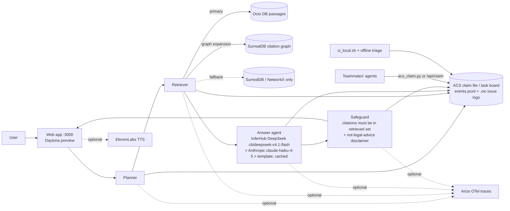

# PLAN — Daytona HackSprint NYC (2026-10-16)

## Event
- Submission **3:30 PM ET**; finalists present **4:00 PM ET**.
- 3 minutes: slides on idea, advantages, safeguards + live demo.
- Judging: sharp reasoning, independent decisions, safe integration with real tools.

## Policy & board
- Policy: `HACKATHON_POLICY.md` — speed > delivery > presentation > completeness; **feature freeze 3:00 PM ET**.
- Task board: `python3 acs_claim.py list` (claim: `python3 acs_claim.py claim HACK-0X --agent <name>`).

## Product
Cited verified research-memo tool for legal professionals (law firms, in-house counsel, litigation support).
> "Cited legal answers for people who can't afford legal research, built and checked by coordinated agents inside Daytona."

## Architecture

## Sponsor usage
- **Daytona**: runtime for all agents, local CI + issue triage without GitHub, preview link, snapshot.
- **SurrealDB**: citation graph (120k nodes / 161k edges) + agent memory.
- **Arize**: OpenTelemetry traces per agent step (needs keys).
- **ElevenLabs**: read the answer aloud (needs key).
- **Anchor Browser**: optional / skip.

## Model policy
InferHub DeepSeek `cb/deepseek-v4.1-flash` → Anthropic `claude-haiku-4-5` → labeled template fallback; on-disk cache; max_tokens ≤ 600. Never print keys. Minimize Anthropic calls.

## Timeline (ET)
- **by 1:30** — pipeline + ACS + Octo + Arize.
- **1:30–2:45** — presentation site (PRD-agent story → frontend), ElevenLabs, board polish.
- **2:45–3:30** — slides incl. safeguards, backup screen recording, submit.

## 3-minute presentation
1. Problem — 20s
2. Idea (ACS + Daytona + ABA) — 30s
3. Live demo — 90s: ask a question, agents light up, safeguard passes, cited answer
4. Why it matters / works with any dataset incl. Hugging Face — 30s
5. Close — 10s
Backup: screen recording.

## Open blockers needing Alex
- Make sandbox public (preview link returns 401).
- Model: RESOLVED - Anthropic claude-haiku-4-5 works (InferHub still blocked). Persist ANTHROPIC_API_KEY in ~/.hack_env so restarts keep it.
- Optional ELEVENLABS_API_KEY / ARIZE_API_KEY + ARIZE_SPACE_ID.

## Run
`./run_all.sh` · `./ci_local.sh` · `python3 agents.py "question"`
